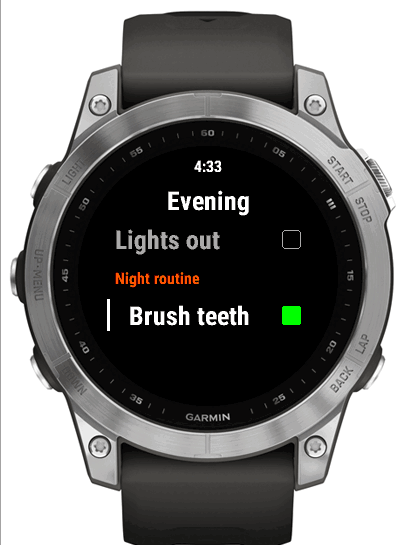

# Trilium Notes

## What maps to what

| Trilium | Checklists |
| --- | --- |
| Note tagged `#checklist` | Checklist |
| A checkbox from the editor's toolbar | Checklist item |
| Line starting `[]` or `[ ]` | Checklist item |
| **Anything already ticked** | **Ignored — never imported** |
| Headings, prose, everything else | Ignored |

A note can hold a checklist *and* notes to self; only the `[]` lines are
imported. Ticking a line in Trilium takes it out of the template, which is
usually what ticking it there is meant to mean.

### Two ways to make an item

**The editor's checkbox button** (*Insert → To-do list*, or the toolbar
checkbox) is the usual one. Tick a box in Trilium and that item stops being
imported.

**Typing `[]` at the start of a line** does the same thing, and is the only
option in a plain-text note:

```text
<h2>Dive kit</h2>            ->  ignored
Packed the night before.     ->  ignored
[] Mask and snorkel          ->  item
[] Fins                      ->  item
[x] Surface marker buoy      ->  ignored, already done
```

Both forms can live in one note. A leading bullet is fine (`- [] Fins`), as is
no space (`[]Fins`). Bold or italic inside the line is stripped. Text notes and
plain-text code notes both work.

## Linking one checklist to another

A checklist item can **link to another note**, and if that note is a checklist
(labelled `#checklist`), its items are shown right there, under the item that
links to it. Use Trilium's own links: *Insert → Link*, or type `@` and pick a
note, inside a checkbox item.

```text
[] Lights out
[] Night routine          <- a link to your "Night routine" note
[] Sleep
```

becomes, on the watch:

|  |
| --- |
| *Night routine* is a heading; its items sit indented beneath it |

- **The item becomes a heading.** It is shown in orange, in smaller type, with
  no box: UP and DOWN step over it, and it does not count towards `n/m done`.
  The linked list's items follow it, indented one step, each with its own box.
- **The linked note only has to be a checklist.** It does not have to be
  imported: if the note a link points at is one the picker would offer -- it
  matches **Which notes**, `#checklist` by default -- its items are included
  anyway, and it is not added to the watch as a list of its own. A link to
  anything else, such as a web page or a note without the label, is left as an
  ordinary item with the link's text. (Only the first 200 matching notes are
  considered, as in the picker, and at most 50 notes are fetched this way per
  sync.)
- **Links nest** up to three levels (a list that links to a list that links to
  a list). A link deeper than that, and a link back to a list that is already
  open, are left as ordinary items, so a loop can never make a list endless.
- **A linked list that is empty** is shown as an ordinary item.
- **The same list may be linked twice**; it is unrolled each time, with its own
  boxes.
- **The linked list is still a checklist of its own**, in the index as usual.
  Its items are copied in at sync time, so editing it in Trilium changes every
  list that links to it, from the next sync.
- **Text around the link stays.** `[] Do the <link> before bed` becomes the
  heading *Do the Night routine before bed*.
- If an item links to several notes, the first one that is a
  checklist is used.
- Everything the link brings in counts towards the 100-item limit below, and
  anything past it is dropped from the end.

This works for Trilium notes only: Vikunja task titles and the bridge's own
lists are plain text and have nowhere to put a link.

Limits: 100 items per checklist, counting what links bring in, 64 characters per item, 32 per name, 200 notes
in the picker.

## Requirements

**Trilium 0.93 or newer**, which is when ETAPI settled. The end-to-end run has
been executed in full against **0.102.2** and **0.105.0**; both behave
identically, so there is no reason to upgrade for this.

Three ETAPI routes are used, and no others:

```text
GET {base}/etapi/notes?search=%23checklist&limit=200&orderBy=title
GET {base}/etapi/notes/{noteId}
GET {base}/etapi/notes/{noteId}/content
Authorization: <token>
```

The token travels bare rather than as `Bearer <token>`: the bare form works on
every version, the Bearer spelling only from 0.93.

To try another version yourself:

```bash
TRILIUM_IMAGE=triliumnext/trilium:v0.102.2 just e2e-trilium
```

## Creating a token

1. Trilium → **Options** → **ETAPI** → **Create new token**.
2. Copy it. ETAPI tokens are read-write by design — the bridge only ever reads,
   but be aware the token itself is not scoped the way Vikunja's is.

## Connecting

On the bridge's web page, tap the **Trilium Notes** tile:

| Field | Value |
| --- | --- |
| Trilium URL | `https://trilium.example.com` (no `/etapi`) |
| ETAPI token | the token from above |
| Which notes | `#checklist` by default |

**Save and test** performs a real search; credentials are stored only if it
succeeds. Then tick the notes you want and **Import selected**.

## Choosing which notes are offered

**Which notes** is a [Trilium search][search], so the default `#checklist` is
only a starting point:

| Search | Offers |
| --- | --- |
| `#checklist` | Notes labelled `#checklist` |
| `#packing OR #dive` | Either label |
| `#checklist #active` | Both labels |
| `note.parents.title = 'Checklists'` | Children of one note |

[search]: https://triliumnext.github.io/Docs/Wiki/search.html

Hidden from the picker: **protected notes** (their content is encrypted and
unreadable over ETAPI, so they would import as empty), and notes that cannot
hold text, such as images.

A note keeps working after import even if you remove its label — the bridge
reads the note directly, so it keeps its name rather than degrading to a
placeholder. It simply stops appearing in the picker.

## Troubleshooting

| Message | Cause |
| --- | --- |
| `Trilium rejected the ETAPI token` | Revoked, copied incompletely — **or a proxy ate the header**, see below |
| `refused … by something in front of Trilium` | The request never reached the ETAPI; see below |
| `could not reach Trilium at …` | Wrong URL, DNS, or the bridge cannot reach the instance |
| `Trilium has nothing at /notes/…` | The note was deleted; untick it in the picker |
| `is not a usable Trilium URL` | Missing `https://`, or `/etapi` left on the end |
| A note is missing from the picker | No `#checklist` label, or it is protected |
| A link shows as plain text, not as a heading | The note it points at does not match **Which notes** (no `#checklist` label), or is an ordinary web link, or would make the list include itself |
| An imported checklist is empty | Nothing in it is a checkbox — neither a toolbar checkbox nor a line starting `[]` |

## When Trilium is behind SSO

If your reverse proxy puts Authelia, oauth2-proxy, Cloudflare Access or similar
in front of Trilium, the bridge is not a browser and has no session, so it gets
turned away before Trilium ever sees it. Two shapes:

- **The proxy refuses outright.** The bridge reports "refused … by something in
  front of Trilium". Trilium's ETAPI answers `401` with a JSON body for a bad
  token and never `403` — verified against 0.102.2 and 0.105.0 — so anything
  else did not come from Trilium.
- **The proxy forwards but consumes the `Authorization` header**, which some
  auth proxies do. Trilium then sees no credentials and answers a genuine
  `401`, so this looks exactly like a wrong token.

Either way the token is not the problem. Three fixes, best first:

1. **Point the bridge at Trilium directly**, bypassing the proxy. On a shared
   Docker network that is `http://trilium:8080` — plain HTTP is fine here, and
   deliberately allowed: only the *watch* needs HTTPS, and only to the bridge.
2. Exempt `/etapi/` from the SSO rule in your proxy.
3. Make the proxy pass `Authorization` through untouched.

To tell which is happening, make the same request the bridge makes, **from the
bridge's own container** — the network path is the point:

```bash
docker exec checklists-bridge python -c "
import urllib.error, urllib.request
url = 'https://trilium.example.com/etapi/notes?search=%23checklist&limit=1'
request = urllib.request.Request(url, headers={'Authorization': 'YOUR_TOKEN'})
try:
    print(urllib.request.urlopen(request).status)
except urllib.error.HTTPError as error:
    print(error.code, error.headers.get('content-type'), error.read()[:200])
"
```

`200` means the bridge can reach it and the token is good. `401` with
`application/json` is Trilium itself. Anything else — HTML, `403`, a login page
— came from in front of it.
